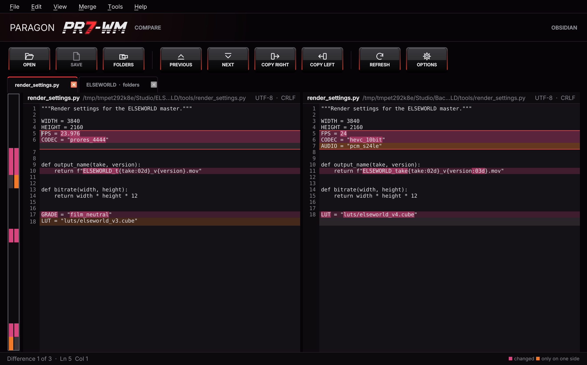
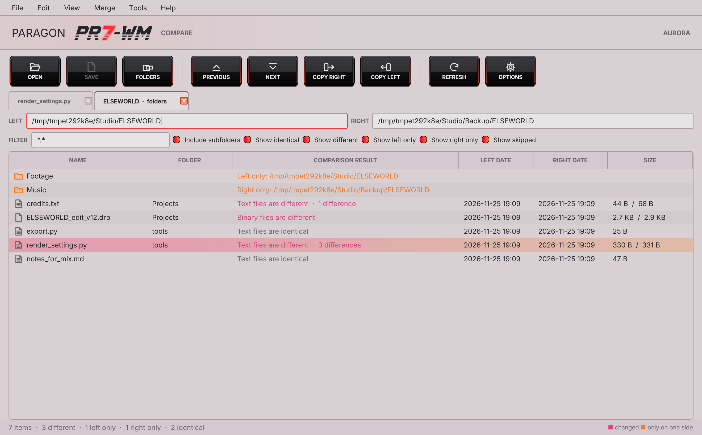
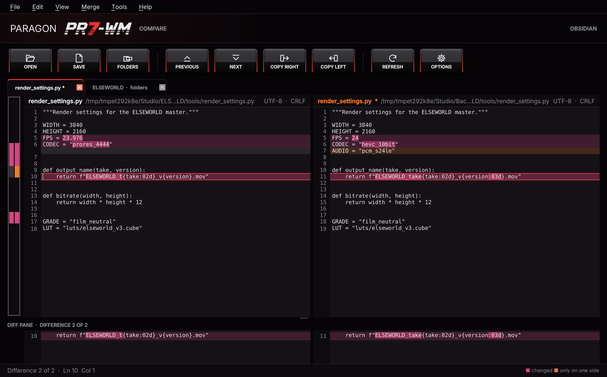

# Paragon PR7-WM

File and folder compare that works the way **WinMerge** works, in the Paragon family look (PR7-Z, PR7-W, PR7-L, PR7-F,
PR7-E, PR7-R, PR7-P, PR7-M, PR7-Q, PR7-U, PR7-DU, PR7-CB, PR7-IS, PR7-PM, PR7-SM, PR7-HB, PR7-FS, PR7-AR). Python and
PySide6.

## What it does

- **File compare:** two texts side by side, lined up line by line.
  - Changed lines are pink, with the changed words marked. Lines on one side only are orange, opposite a blank filler.
  - The **location pane** down the left shows every difference at once; click it to jump there.
  - The **Diff pane** (View) shows the current difference word by word.
- **Merging:**
  - **Copy to Right / Left** (Alt+Right / Alt+Left) and **Copy All**. Copied lines take the other file's line endings,
    and nothing else in that file changes.
  - Type in either side; it's compared again as you go.
  - **Undo / Redo** cover merges and typing together. **Save** keeps each file's encoding, byte-order mark and line
    endings: a side saved unchanged is the same bytes.
- **Moving around:** **Next / Previous / First / Last / Current difference** (Alt+Down, Alt+Up, Alt+Home, Alt+End,
  Alt+Enter), Find (Ctrl+F, F3) and Go To (Ctrl+G).
- **Options** (WinMerge's): ignore whitespace (compare / ignore changes / ignore all), ignore blank lines, ignore case,
  ignore carriage return differences (on by default), and word- or character-level marks.
- **Folder compare:** every file's result.
  - Text files identical or different, with how many differences; binary files identical or different; left only /
    right only.
  - Compare methods: full contents, quick contents, modified date, date and size, size.
  - WinMerge's filter masks (`*.*;!*.bak;!.git\`), Include subfolders, and Show identical / different / left only /
    right only / skipped.
  - Double-click a file to compare it. **Copy to Right / Left** and **Delete** (to the Recycle Bin) ask first.
- **Binary files** are told apart and compared byte for byte.
- **Generate Patch** (Tools) writes a unified diff.
- A file changed by another program while it's open is offered for reloading.
- **Binary files** open in PR7-HX (the family's hex editor) from the File menu or the folder compare's menu, when
  it's installed.
- **Explorer menu:** "Compare in PR7-WM" on files and folders. Select two items, or one now and another later
  (WinMerge's Select Left / Compare to).
- **Command line:** WinMerge's switches: `PR7-WM.exe [/r] [/e] [/wl] [/wr] [/dl DESC] [/dr DESC] [/f FILTER] LEFT RIGHT`.

## Building

`pip install -r requirements.txt -r requirements-dev.txt`, `python -m pytest`, `pyinstaller pr7wm.spec`, then Inno Setup:
`iscc /DAppVersion=x.y.z installer\pr7wm.iss`.
